# BDX Analysis System

## Overview

A configuration-driven Python framework for analyzing particle simulation data stored in ROOT files by [FlukaROOTOutput](https://github.com/AntoninoFulci/FlukaROOTOutput).

Typical analysis outputs include energy spectra, spatial maps and comparisons between configurations:

<div align="center">
  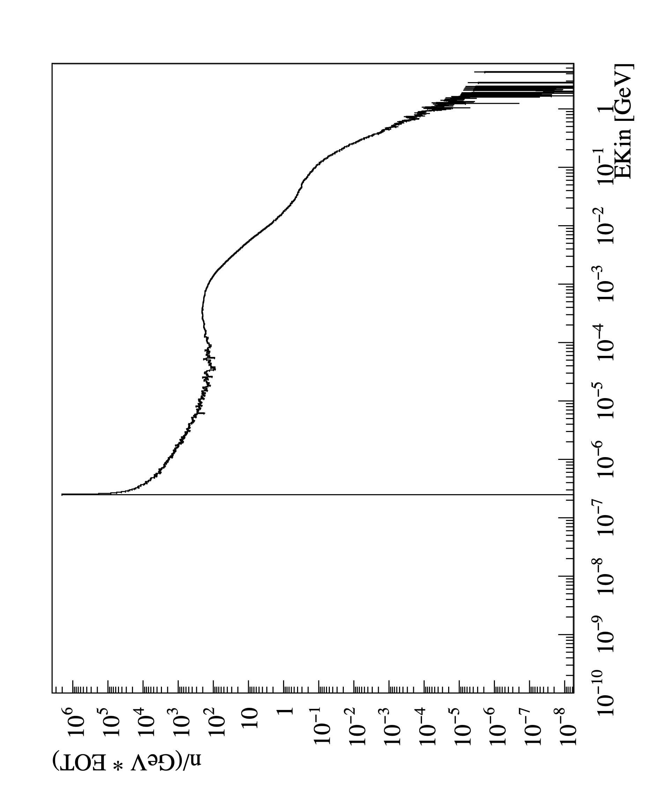
  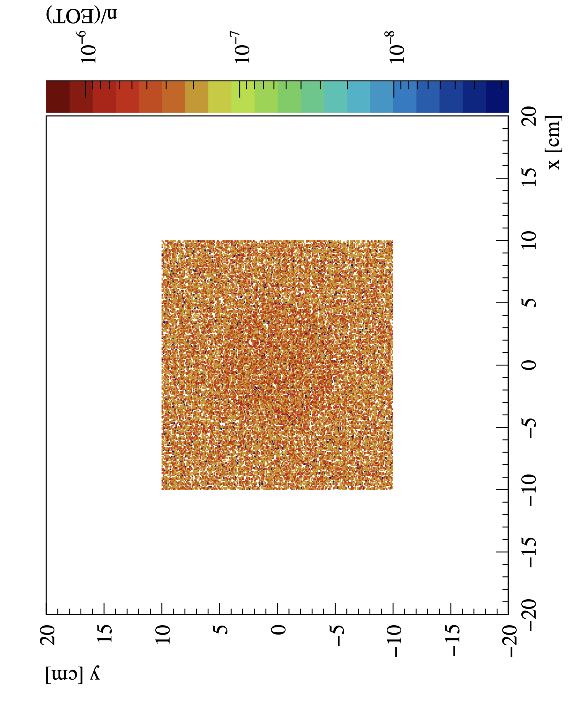
</div>

<div align="center">
  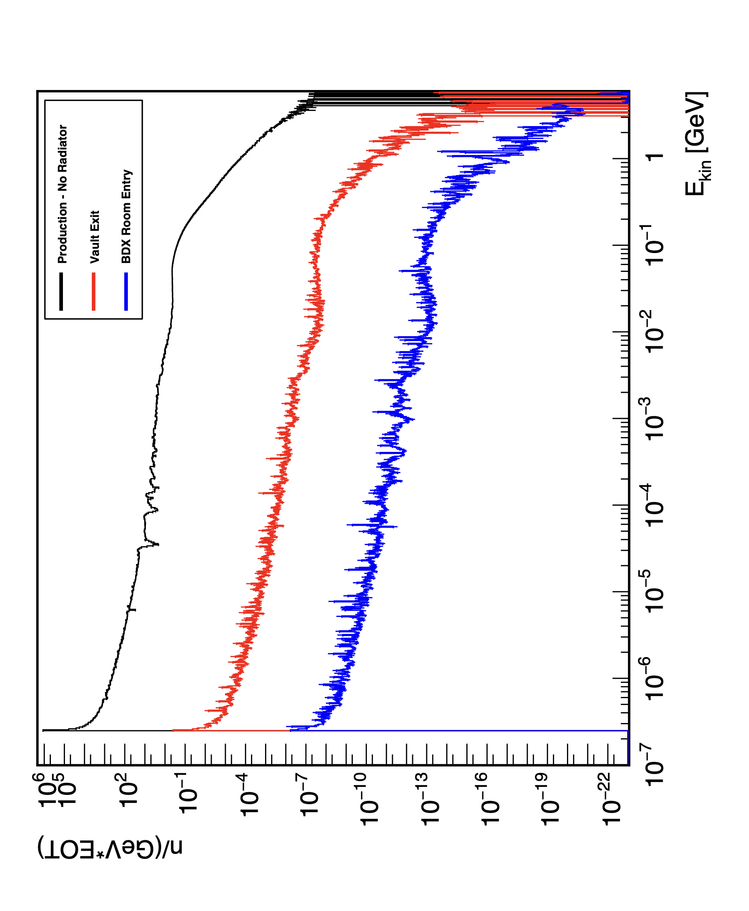
</div>

### Key Features

- **YAML/JSON configuration** for analysis and standalone comparisons
- **Single- and multi-particle filtering** using FLUKA particle IDs
- **Linear and logarithmic energy binning**, with multiple energy ranges
- **Spatial analysis** on XY, XZ or YZ surfaces and all six faces of a box
- **Derived variables and statistical weights** through ROOT expressions
- **Histogram comparisons** with configurable colors, legends and axis ranges
- **Selective Gaussian smoothing** in overlay or replacement mode
- **Selective, density-preserving rebinning**, including multiple output variants
- **ROOT, PDF, ROOT macro and Excel/CSV output** with EOT normalization
- **Batch execution, prerequisite configurations and parallel RDataFrame processing**

### Project Structure

```text
BDX-FLUKA-Analysis/
├── run_analysis.py               # Command-line entry point
├── src/
│   ├── __init__.py               # Public Python API
│   ├── analysis.py               # CLI, prerequisites and batch processing
│   ├── core.py                   # Filters, histogram booking and normalization
│   ├── config.py                 # YAML/JSON configuration
│   ├── histogram.py              # Histogram containers
│   ├── simulation_summary.py     # EOT and run timing
│   ├── comparison.py             # Overlays, smoothing and rebinning
│   ├── export_histograms.py      # PDF, macro and statistics export
│   ├── term_logging.py           # Terminal output
│   └── utils.py                  # ROOT setup and units
├── configs/examples/             # Analysis and comparison templates
├── imgs/                         # README figures
└── README.md
```

---

## Getting Started

### Prerequisites

- Python 3 with a matching, working PyROOT installation
- `numpy`, `pint` and `pyyaml` for analysis
- `scipy` for Gaussian smoothing
- `pandas` and an Excel engine such as `openpyxl` for Excel export
- `tabulate` for comparison statistics

The analysis and feature figures have been exercised with ROOT 6.40.04. Install Python packages in the environment that provides PyROOT:

```bash
python3 -m pip install numpy pint pyyaml scipy pandas openpyxl tabulate
```

Input files must contain an `Events` tree and a `RunSummary` tree. Analysis uses the configured particle, surface, coordinate, variable and weight branches; the run summary reads `TotEvents`, `AvgTime`, `StartTime` and `TotTime`.

### Quick Start

1. **Basic Analysis Run:** edit the input directory, surface ID and bounds in [01_particle_analysis.yaml](configs/examples/01_particle_analysis.yaml), then run:

```bash
python3 run_analysis.py configs/examples/01_particle_analysis.yaml
```

2. **Override Input and Output Directories:**

```bash
python3 run_analysis.py -i /path/to/Simulation --output-dir ./results configs/examples/01_particle_analysis.yaml
```

3. **Also Save ROOT Macros:**

```bash
python3 run_analysis.py --save-macro configs/examples/01_particle_analysis.yaml
```

The example creates linear and logarithmic neutron spectra plus a spatial map. Its output directory contains:

```text
results/
├── simulation_summary.root
├── analysis_neutrons_200bins_100.0keV_10.0GeV.root
├── histogram_statistics.xlsx
└── plots/
    ├── 00_200bins_100.0keV_10.0GeV_neutrons_h1_detector_lin.pdf
    ├── 00_200bins_100.0keV_10.0GeV_neutrons_h1_detector_log.pdf
    └── 00_200bins_100.0keV_10.0GeV_neutrons_h2_detector.pdf
```

PDF names include a zero-based ordering prefix, binning, energy range and histogram name. `--save-macro` adds matching `.C` files. Without an available Excel engine, analysis statistics fall back to CSV.

### Command Line Options

| Option | Behavior |
|---|---|
| `-i`, `--input-dir` | Override the input ROOT directory |
| `--output-dir` | Override the analysis output directory |
| `--config-dir` | Recursively run YAML/JSON files in a directory, instead of one config |
| `--no-save-pdf` | Skip post-analysis histogram PDF export |
| `--no-save-hstat` | Skip post-analysis statistics export |
| `--save-macro` | Save `.C` macros alongside plots |
| `--remove-runsummary` | Rebuild the cached run summary and EOT |

```bash
python3 run_analysis.py --config-dir ./my_configs
python3 -m src.analysis --help
```

PDF and statistics export are enabled by default. The `--no-save-*` flags control post-analysis exports; comparison plots and their statistics are generated directly by each comparison. A comparison's explicit `output_directory` takes precedence over the CLI output directory.

When `simulation_summary.root` exists, its EOT is reused with a warning: input identity is not verified. After changing datasets, use a new output directory or `--remove-runsummary`.

---

## System Architecture

### Data Flow

```text
ROOT input → Derived variables → Particle/surface filters → Histograms
                                                             ↓
                                        EOT normalization → ROOT/PDF/Excel

Existing ROOT spectra → Selected rebin → Selected smoothing → Comparison plots
```

### Core Processing Pipeline

1. Load configuration and run enabled prerequisites.
2. Read simulation events through ROOT's parallel `RDataFrame`.
3. Define derived variables, then apply particle, surface and energy selections.
4. Book linear/logarithmic spectra and optional spatial maps.
5. Normalize to the number of primary events (EOT), write ROOT outputs and run configured comparisons.
6. Export the analysis plots and statistics.

Spectra store **n/(GeV·EOT)**. Spatial maps store **n/EOT per pixel**, without division by pixel area. Surface dimensions define the acceptance; area normalization is not automatic.

---

## Configuration Guide

### Configuration File Structure

YAML and JSON use the same fields. A complete analysis configuration can contain:

```yaml
input_directory: ./simulation
particle:
  particle_id: 8
  name: neutrons
  variable: EKin
  weight: Weight1
new_variable:
  name: EKin
  expression: ETot - 0.939565378
new_variables:
  - name: Beta
    expression: P / ETot
output:
  base_name: analysis
  directory: ./results
  include_timestamp: false
  format_template: '{base_name}_{particle_name}_{n_bins}bins_{min_energy}_{max_energy}.root'
histograms:
  - n_bins: 200
    min_energy: 0.0001
    max_energy: 10.0
    also_log_bins: true
surfaces:
  - id: 1000
    name: detector
    xl: -30
    xh: 30
    yl: -30
    yh: 30
    bin_width: 1.5
    spatial_analysis: true
box_surfaces:
  - name: detector_box
    surface_id: 101
    xmin: -20
    xmax: 20
    ymin: -20
    ymax: 20
    zmin: -20
    zmax: 20
    bin_width: 2.0
    spatial_analysis: true
```

Change IDs, branch names and geometry to match your simulation. Relative data/output paths are resolved from the working directory; prerequisite configuration paths are resolved relative to the configuration that declares them.

### Particle Configuration

Use [FLUKA particle codes](https://flukafiles.web.cern.ch/manual/chapters/particle_and_material_codes/particles_codes.html), rather than PDG codes.

```yaml
particle:
  particle_id: 8
  name: neutrons
  variable: EKin
  weight: Weight1
```

| Particle | FLUKA ID |
|---|---:|
| Neutron | 8 |
| Electron | 3 |
| Positron | 4 |
| Muon, positive | 10 |
| Muon, negative | 11 |
| Photon | 7 |

Multiple IDs can share one analysis: `particle_id: [3, 4]` combines electrons and positrons.

### Energy Range Configuration

Energies are in **GeV**. Every histogram configuration produces a linearly binned spectrum. `also_log_bins: true` adds a logarithmically binned spectrum; its minimum energy must be positive.

```yaml
histograms:
  - n_bins: 200
    min_energy: 0.0001
    max_energy: 10.0
    also_log_bins: true
  - n_bins: 100
    min_energy: 0.0001
    max_energy: 0.01
    also_log_bins: false
```

Histogram names use the particle and surface names, for example `neutrons_h1_detector_lin`, `neutrons_h1_detector_log` and `neutrons_h2_detector`.

The new feature figures below use deterministic **synthetic demonstration data**, processed through this framework. They illustrate behavior, not physical predictions.

<div align="center">
  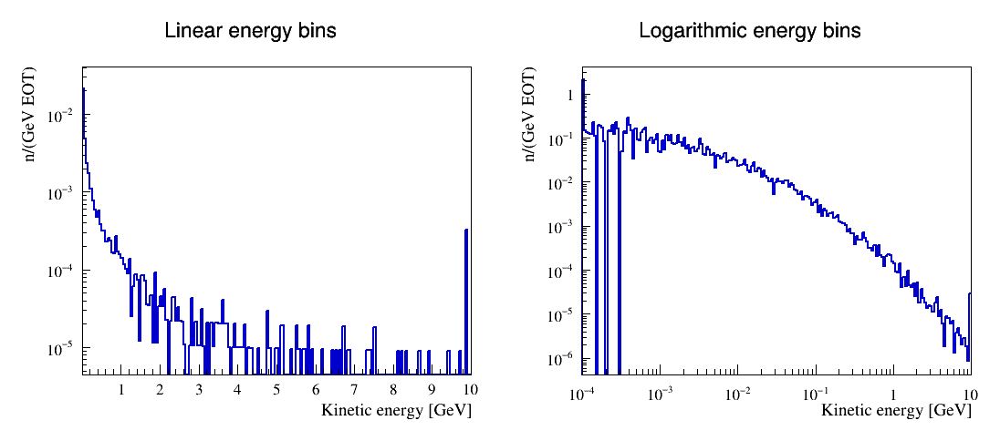
</div>

### Surface Analysis Configuration

#### Standard Surfaces

Specify two coordinate ranges to choose an XY, XZ or YZ map. The same bounds select the acceptance for 1D spectra.

```yaml
surfaces:
  - id: 1000
    name: detector
    xl: -30
    xh: 30
    yl: -30
    yh: 30
    bin_width: 1.5
    spatial_analysis: true
  - id: 1001
    name: side
    yl: -30
    yh: 30
    zl: -30
    zh: 30
    bin_width: 1.5
    spatial_analysis: true
```

Set `spatial_analysis: false` to keep spectra without a 2D map.

<div align="center">
  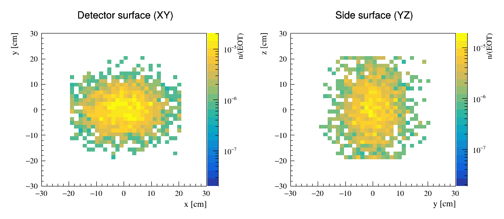
</div>

#### Box Volume Analysis

A `box_surfaces` entry generates spectra and optional spatial maps for all six faces. The example in the complete configuration above produces:

<div align="center">
  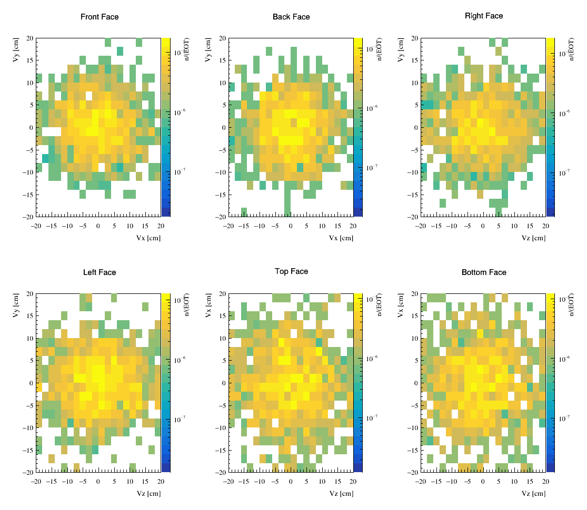
</div>

Face names are `front_face`, `back_face`, `right_face`, `left_face`, `top_face` and `bottom_face`. For example: `neutrons_h1_detector_box_front_face_log`. Events are assigned using the configured surface ID and exact face-coordinate values, so bounds must match the simulation geometry.

---

## Usage Examples

### Basic Neutron Analysis

[01_particle_analysis.yaml](configs/examples/01_particle_analysis.yaml) defines kinetic energy, weighted neutron spectra, linear/log bins and a detector map. Configure the simulation directory and surface before running it.

### Multi-Energy Range Analysis

Add entries under `histograms` to analyze additional ranges in separate ROOT files. Keep output names distinct: values are formatted with energy units, and configurations that round to the same output filename are rejected before histogram writing.

### Comparison Analysis

Comparisons can run alone, without an input simulation directory:

```yaml
comparisons:
  - output: config_comparison
    output_directory: ./results/comparisons
    hists:
      - [results/config_a.root, neutrons_h1_detector_log, Configuration A, kP6Blue, 0]
      - [results/config_b.root, neutrons_h1_detector_log, Configuration B, kP6Red, 1]
    title: Neutron spectrum comparison
    x_label: Kinetic energy [GeV]
    y_label: n/(GeV EOT)
    logx: true
    logy: true
    x_min: 0.0001
    x_max: 10.0
```

```bash
python3 run_analysis.py --save-macro configs/examples/02_comparison_analysis.yaml
```

Replace the example ROOT paths and histogram names with your existing outputs. Each row contains exactly `[file, histogram, label, color, legend_order]`; lower numeric order appears first in the legend. Separate legacy `files`, `labels`, `colors`, `legend_order`, `labels_and_colors` and `files_name*` configuration fields are unsupported.

### Configuration Prerequisites

Run analyses before a dependent comparison by declaring configuration paths:

```yaml
requirements:
  - [analysis_a.yaml, true]
  - [analysis_b.yaml, true]
  - [optional_analysis.yaml, false]
comparisons:
  # Add the comparison entries here.
```

Disabled prerequisites are skipped. Missing prerequisites and dependency cycles fail the configuration. Batch execution reports successful and failed configurations and exits with a nonzero status when any fail.

### Example Configuration Index

| Template | Demonstrates |
|---|---|
| [01_particle_analysis](configs/examples/01_particle_analysis.yaml) | Derived energy, weighted spectra and spatial map |
| [02_comparison_analysis](configs/examples/02_comparison_analysis.yaml) | Standalone spectrum overlays |
| [03_legend_order_demo](configs/examples/03_legend_order_demo.yaml) | Legend order through the fifth row field |
| [04_label_colors_demo](configs/examples/04_label_colors_demo.yaml) | Integer and named ROOT colors |
| [05_accessible_colors_demo](configs/examples/05_accessible_colors_demo.yaml) | Accessible palettes and mixed colors |
| [08_smoothing_demo](configs/examples/08_smoothing_demo.yaml) | Selective Gaussian smoothing |
| [09_rebin_demo](configs/examples/09_rebin_demo.yaml) | Selective rebin and multiple independent variants |

---

## Advanced Features

### 1. Custom Energy Variables

`new_variable` defines one derived column; `new_variables` defines additional columns in order. Expressions use ROOT/C++ syntax and can refer to existing or previously defined columns.

```yaml
new_variable:
  name: EKin
  expression: ETot - 0.939565378
new_variables:
  - name: Beta
    expression: P / ETot
```

The neutron energy-binning figure above uses this derived `EKin` column. Names must be new columns; defining a variable does not automatically create another histogram. Select the desired column through `particle.variable`.

### 2. Multi-Particle Analysis

```yaml
particle:
  particle_id: [3, 4]
  name: leptons
  variable: EKin
  weight: Weight1
new_variable:
  name: EKin
  expression: ETot - 0.000510999
```

Run separate configurations for distinct species and compare their outputs. In this example the combined electron/positron spectrum uses `[3, 4]`:

<div align="center">
  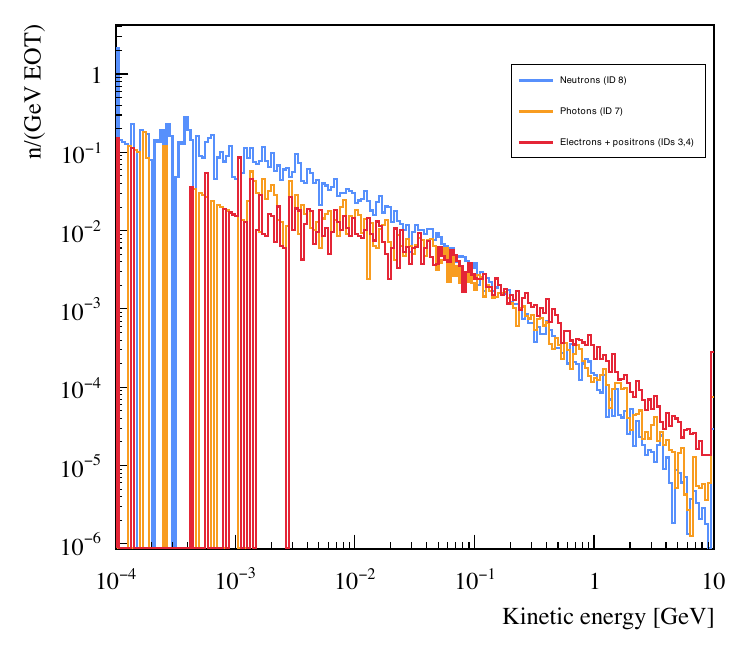
</div>

### 3. Statistical Weighting

`particle.weight` names a column, such as `Weight1` or `Weight2`. To use a constant or expression, define a column first:

```yaml
new_variables:
  - name: UnitWeight
    expression: '1.0'
particle:
  particle_id: 8
  name: neutrons
  variable: EKin
  weight: UnitWeight
```

This fragment assumes `EKin` has also been defined. A literal `weight: '1.0'` is not a column name and cannot be used directly.

<div align="center">
  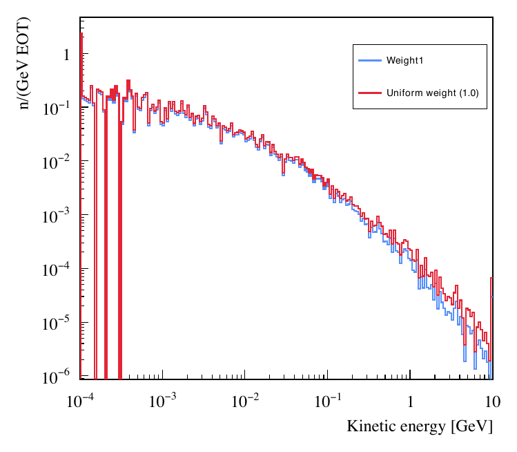
</div>

### 4. Flexible Output Naming

```yaml
output:
  base_name: detector_study
  directory: ./results
  format_template: 'spectra/{base_name}-{particle_name}-{n_bins:04d}-{min_energy}-{max_energy}.root'
  include_timestamp: true
```

PDF and statistics discovery follows the same naming template, including custom separators, subdirectories and timestamps. Energies are formatted strings with units; `n_bins` is an integer. Keep both `{min_energy}` and `{max_energy}` for energy-range sorting and labels. The default template remains `{base_name}_{particle_name}_{n_bins}bins_{min_energy}_{max_energy}.root`.

### 5. Histogram Comparison

Besides the five-field `hists` rows, comparisons accept:

- `x_min`, `x_max`, `y_min`, `y_max`, or `plot_range: {x_range: [...], y_range: [...]}`; `plot_range` takes precedence.
- `legend_position`, either a preset such as `top_right` or four coordinates `[x1, y1, x2, y2]`.
- ROOT color names/codes in each row, including accessible `kP6`, `kP8` and `kP10` palette colors.
- `line_width`, `draw_option` and `draw_option_extra`, for example `hist` with `e` error bars.
- `use_scientific_notation_x` for X-axis formatting.

At least two histograms must be available. Missing histograms generate warnings; if two remain, their original labels, colors and selection indices are preserved. Fewer than two cause an error and a nonzero CLI exit status.

### 6. Gaussian Smoothing

```yaml
smoothing: overlay
smooth_hists: [1, 2]
smoothing_sigma: 3
raw_alpha: 0.25
smooth_line_width: 2
# smooth_x_max: 6.0
```

Modes are `off` (default), `overlay` (faint original plus bold smoothed curve) and `replace` (smoothed curve only). `smooth_hists` accepts zero-based input indices or exact labels; omit it to smooth all curves. Smoothing is Gaussian in log-content space, skips empty bins and clips to the filled range, optionally limited by `smooth_x_max`.

<div align="center">
  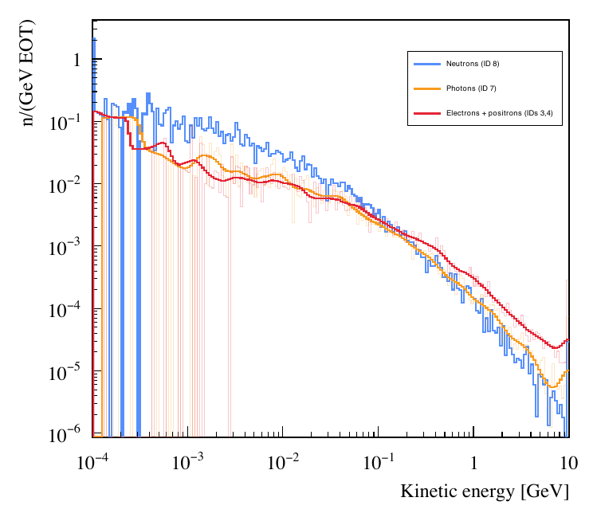
  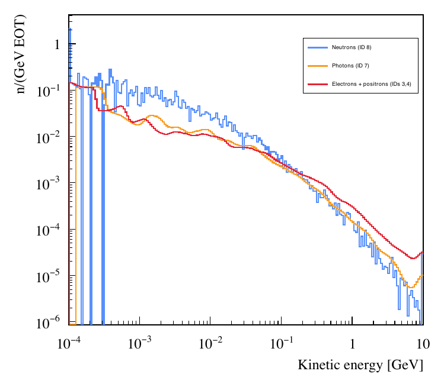
</div>

Left: overlay. Right: replace. The blue reference is unselected in both. Sigma is measured in histogram bins. These curves are for visualization: integral conservation is not guaranteed, and smoothed clones retain the original bin errors rather than propagated smoothing uncertainties.

### 7. Selective Rebin and Multiple Variants

```yaml
rebin: [5, 10]
rebin_hists: [1, 2]
smoothing: overlay
smooth_hists: [1, 2]
smoothing_sigma: 2
```

`rebin_hists` accepts zero-based original input indices, exact labels or a mixture. Omit it (or use `null`) to select all; `[]` selects none. Unselected spectra keep their original bins. Invalid indices, unknown labels and ambiguous duplicate labels are errors; use indices to distinguish duplicate labels.

A scalar such as `rebin: 5` retains the configured output name. A list produces separate figures with suffixes `_rebin5`, `_rebin10`, etc., including corresponding Excel files and optional `.C` macros. Even a one-element list adds the suffix. Use `[1, 5, 10]` to include original binning; default is `1`. Every variant starts from the original data.

<div align="center">
  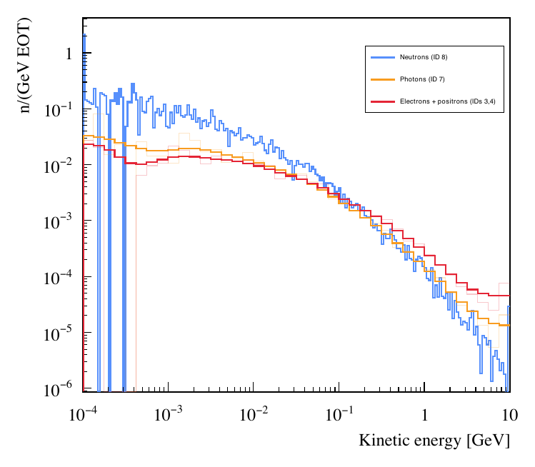
  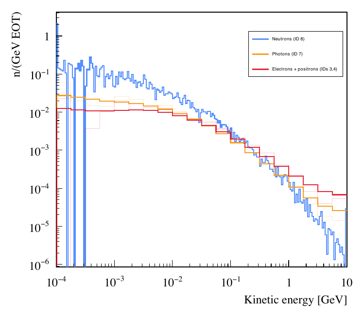
</div>

Left: factor 5. Right: factor 10. Blue keeps its original binning; the other curves are rebinned before smoothing. `rebin_hists` and `smooth_hists` are independent. Sigma stays constant across variants and counts each curve's bins after any rebin.

Rebin factors must be unique positive integers and divide the selected available spectra's bin counts exactly, retaining the full energy range. Supported spectra are `TH1F`/`TH1D`, with uniform or variable-width bins. Empty factor lists, profiles and non-floating spectra are rejected when rebinning is requested.

Density normalization is preserved: multiply contents/errors by original bin widths, group with [ROOT `TH1::Rebin`](https://root.cern.ch/doc/master/classTH1.html), then divide by new widths. Width-weighted integrals and their uncertainties are conserved up to floating-point roundoff. Input files remain unchanged; this conservation applies before any optional smoothing.

### 8. Statistics and Reproducible Exports

Analysis writes a statistics workbook with yields, uncertainties, detector names and energy ranges. Spatial TH2 maps take precedence over 1D spectra for each detector: maps are summed without pixel-area weighting; 1D differential spectra are integrated with bin widths. Only regular bins enter these yields.

<div align="center">
  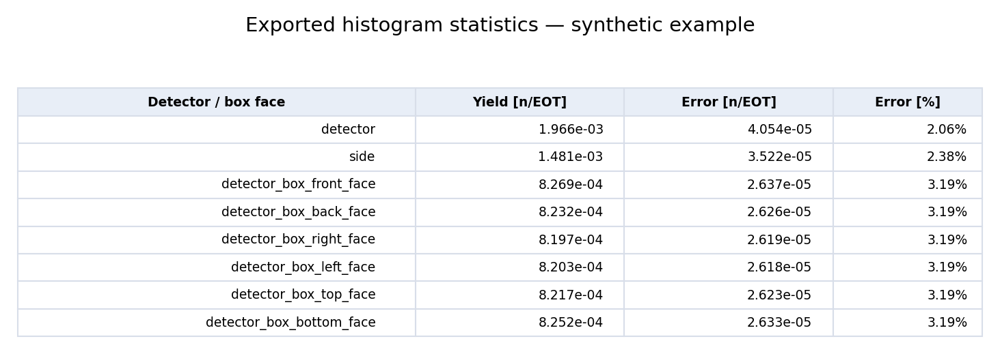
</div>

Each comparison also creates its own workbook using original unsmoothed spectra. Rebin variants retain identical statistics. Save ROOT macros with `--save-macro` to reproduce and edit the plotted canvas in ROOT. Results are normalized to EOT, and run timing is stored in `simulation_summary.root`.

---

*Last updated: October 2026*
